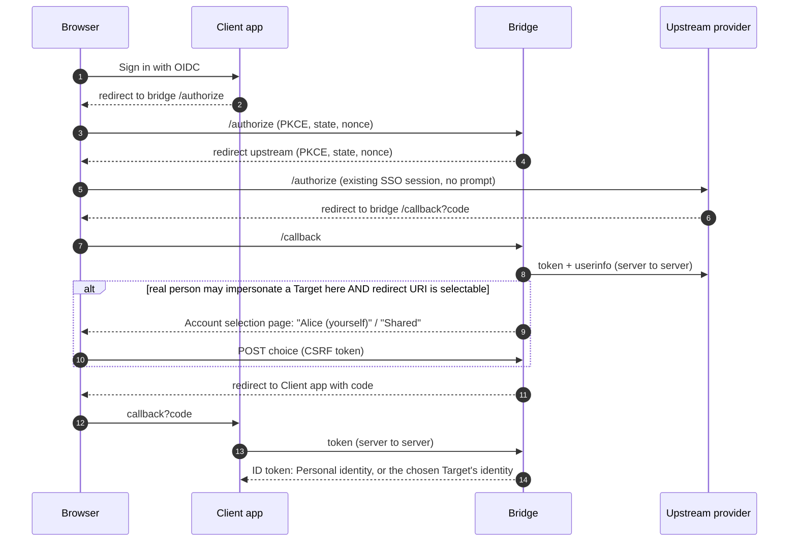

# oidc-impersonation

An OIDC **impersonation bridge**. It sits between your apps and your SSO and lets an
authenticated person **impersonate another account**, for example a shared household account or
a role account, inside any OIDC-capable app. They can return to their own account later:
- in the same browser profile
- with no shared password
- with their own SSO login and 2FA
- with every impersonation logged under the real person's name

Apps are not modified. To them, the bridge is a normal OIDC provider, and an impersonation looks
like an ordinary sign-in of the impersonated account.

> **Status: pre-release.** Everything below is implemented and covered by the e2e stack (real
> Authelia and Immich); no version has been released yet. This README is the deployment contract.

- Glossary: [`CONTEXT.md`](CONTEXT.md)
- Decisions: [`docs/adr/`](docs/adr/)

## Concepts

| Term | Meaning |
|---|---|
| **Upstream provider** | Your SSO (any OIDC provider). It authenticates people and says which groups they're in. |
| **Client app** | An app that signs in through the bridge. |
| **Real person** | Whoever actually authenticated upstream. |
| **Personal identity** | The real person's own upstream identity, passed to the app unchanged. |
| **Target** | A configured account real people may impersonate, together with the claims the app should receive for it. |
| **Impersonation** | A sign-in in which the bridge issues a Target's identity on behalf of a real person allowed to use it. |
| **Account selection page** | The bridge page where the real person picks *themselves* or a Target. It is the only way to start an impersonation. |

## How it works

The bridge is an **OIDC provider** toward Client apps and an **OIDC client** toward the Upstream
provider ([ADR 0001](docs/adr/0001-chained-oidc-bridge.md)). It keeps no login session of its own:
every sign-in makes a silent round trip upstream, so identity and group membership are always
fresh ([ADR 0002](docs/adr/0002-no-bridge-login-session.md)). For the same reason, a request with
`prompt=none` always fails with `login_required`.



### Personal identity (default)

The real person's upstream `sub`, `email`, `name` and `preferred_username` are passed through
unchanged, so existing app users keep matching. Role and admin claims are never forwarded.

The upstream provider may also have its own account for a Target, for example a `family` SSO
user. If the real person's upstream `sub` equals a Target's `claims.sub`, they *are* that account,
so they get it as their Personal identity, with no impersonation. If that account may also
impersonate other Targets, the Account selection page lists those as usual.

If the real person's upstream `email` equals a Target's `claims.email` (compared
case-insensitively) but their `sub` doesn't match that Target, the sign-in **fails** and is logged
as `email-collides-with-target`. Many apps link accounts by email, so passing such an identity
through could hand the person the Target's account. It always means the upstream provider is
misconfigured.

### Impersonation

To impersonate a Target, or to stop, log out of the app with its own button and sign in again
([ADR 0004](docs/adr/0004-impersonate-by-signing-in-again.md)).

- **When the page appears:** only if the real person may impersonate at least 1 Target for this
  client **and** the redirect URI is listed as selectable. Otherwise they get their Personal
  identity silently. For example, keep phone-app redirect URIs out of the selectable list so
  phones never impersonate.
- **What it takes:** each account is a card with its name, its email and a **Log in** button;
  the Personal identity comes first. Only a click on a Target's button issues a Target identity. The click is a form POST with a CSRF token, under `frame-ancestors 'none'`. A link
  alone can never start an impersonation.
- **Who may impersonate a Target:** that comes from the upstream groups claim, matched against
  the Target's allowed groups. There is no user allowlist in the bridge.
- **What the app receives:** exactly the Target's configured claims, in the ID token **and** from
  userinfo. Both always describe the same identity, so the real person's data never leaks into an
  impersonation, and the reverse. The app can't tell the session apart from a normal sign-in of
  that account. Attribution lives in the bridge's [audit log](#audit-log).

### Impersonation session limits

Many apps never expire their own sessions. For Client apps that support **OIDC back-channel
logout**, the bridge ends impersonation sessions itself
([ADR 0003](docs/adr/0003-impersonation-session-cap-via-backchannel-logout.md)):
- every sign-in to such an app gets a fresh `sid` in its ID token
- when the app redeems the code of an impersonation, the bridge records the session in its
  [store](#store)
- after the Target's `session_ttl`, the bridge POSTs a signed logout token for that `sid` to the
  app. If the POST fails, it retries every 30 s for about 10 min, then gives up and logs `failed`;
  the session then lasts as long as the app keeps it.
- the record survives a bridge restart: pending logouts resume, and one that fell due while the
  bridge was down is sent right away. A restart signs nobody out.
- if the store lost the record (Valkey restarted without persistence, was replaced, or the bridge
  didn't run for 30 days), the next start can't know which sessions are open. It then sends 1
  logout per Target by the Target's `sub` alone, which ends **every** session of that account in
  the app, including sessions opened directly with an upstream account that *is* the Target.

Personal sessions are never limited. Apps without back-channel logout keep their own session
lifetime.

## Deployment

### Image

`ghcr.io/mlewando/oidc-impersonation:<version>` (also `<major>.<minor>` and `sha-<commit>`),
built on each `vX.Y.Z` tag for `linux/amd64` and `linux/arm64`. Pin it by digest: each GitHub
Release names its image's digest.
- distroless Node 24 (no shell, no package manager)
- runs as non-root (`nonroot`, uid 65532)
- works with a read-only root filesystem (`read_only: true`); it writes nothing to disk
- has a built-in `HEALTHCHECK` (`/nodejs/bin/node src/healthcheck.ts`, every 30s); `node` is not
  on `PATH`, so use the full path if you override it
- keeps no state of its own: everything it must remember between requests lives in **Valkey**
  (see [Store](#store)), so a restart drops nothing
- needs no access to any app's database or admin API

### Store

The bridge keeps its state in Valkey (Redis works too)
([ADR 0005](docs/adr/0005-state-in-valkey.md)): authorization codes, access tokens, grants,
sign-ins in progress, the identity issued by each sign-in, and the open Impersonation sessions
whose logout is still due (see [Impersonation session limits](#impersonation-session-limits)).
Every entry expires on its own: protocol state after at most `access_token_ttl` or 10 min,
whichever is longer; an Impersonation session 30 days after its `session_ttl`; the session
registry's marker 30 days after the bridge last ran.

- Give the bridge **its own** Valkey, or at least its own ACL user and `key_prefix`. Don't share
  it with an app: its entries let whoever reads them redeem codes and tokens.
- Connect over TLS (`rediss://`) with a password (`password_file`), even on a private network.
  A private CA goes in `NODE_EXTRA_CA_CERTS`.
- Persistence (RDB/AOF) is optional. Without it, a Valkey restart drops sign-ins in progress and
  the session registry; the bridge then logs out every Target at its next start. With it, those
  entries are written to Valkey's disk; protect that disk like a secret.
- The bridge starts without Valkey and retries; `/healthz` stays `503` while Valkey is unreachable.

### Network

| | |
|---|---|
| Listen | `port` (default `8080`) on `listen_address` (default: every interface). HTTPS when `tls` is configured, otherwise plain HTTP. See [Listen address](#listen-address). |
| Public URL | Its own host name, equal to `issuer`, which must be `https://` (only `http://localhost` is accepted, for development). |
| Proxy headers | `X-Forwarded-Proto/Host/For` are trusted only from `trusted_proxies`. If that list is empty, they are ignored. |
| Outbound | The Upstream provider (discovery, token, JWKS, userinfo), the Valkey store, and Client apps' back-channel logout URLs (private addresses are fine; the bridge only ever calls URLs from its config). |
| Inbound | Browsers, plus Client app servers (discovery, token, JWKS, userinfo). |
| Health | `GET /healthz` with HTTP basic auth (`healthz` in the config; anything else gets `401` and learns nothing). Returns `200` once config is valid, Valkey answers and upstream discovery succeeded, and afterwards as long as Valkey answers. Until then the bridge listens but answers `503` on every route, and retries every 2 s. The image's built-in `HEALTHCHECK` runs `src/healthcheck.ts`, which reads only `port`, `listen_address`, `tls` and `healthz` from the same config file, so a secret being rotated never marks a running bridge unhealthy. It connects to `listen_address` (or to `127.0.0.1` when the bridge listens on every interface). |

#### Listen address

By default the bridge listens on every interface. Set `listen_address` to 1 IP address to listen
on that address only, for example `127.0.0.1` or `::1` when a reverse proxy on the same host is
the only client:

- It must be an IP address, not a host name: `localhost`, `[::1]`, `127.0.0.1:8080` and zone ids
  (`fe80::1%eth0`) are rejected. Only 1 address is supported.
- Omit it for the default: dual-stack (`::`), or IPv4 only (`0.0.0.0`) on a host without IPv6.
  An explicit address is never widened or replaced: `::` on a host without IPv6, or an address
  the host does not have, stops the bridge at startup (exit code 1, 1 line on stderr). Use
  `0.0.0.0` for IPv4 only.
- **In a container, leave it unset or use `0.0.0.0`.** `127.0.0.1` inside a container is not
  reachable through published ports (`-p`) or from other containers. To restrict who can reach the
  bridge, publish the port on the host's loopback instead (`-p 127.0.0.1:8443:8443`).
- The image's `HEALTHCHECK` follows it: it connects to `listen_address`, or to `127.0.0.1` when
  the bridge listens on every interface (unset, `0.0.0.0`, `::`).

#### Use HTTPS on every hop

Authorization codes, client secrets, ID tokens and the bridge's cookies all pass through the
bridge's listener. **Serve it over HTTPS**, whatever sits in front of it:
- **Directly exposed:** configure `tls` with a publicly trusted certificate.
- **Behind a reverse proxy or tunnel:** still configure `tls`, and have the proxy verify the
  bridge's certificate. A self-signed certificate pinned in the proxy is enough. The proxy then
  sets `X-Forwarded-*`, and its address goes in `trusted_proxies`.

Plain HTTP works, but use it only for local development, or when the proxy and the bridge talk over
a channel nobody else can read (the same host's loopback interface). Even then, HTTPS costs little.
The bridge logs a warning at startup when it runs without `tls`.

The certificate and key files are re-read automatically when they change, so renewals (for example
ACME, or a cron job) need no restart. The bridge checks them every 5 s, which also catches files
replaced by rename or through a symlink swap (Kubernetes secrets, Podman secrets). If the new pair
can't be loaded, the bridge logs `TLS reload failed` and keeps serving the current certificate.

### Configuration

1 YAML file, whose path is set by `CONFIG_FILE` (default `/config/config.yaml`). Secrets are only
ever **read from files** (`*_file` keys), never from inline values or env vars. The bridge
validates the whole file at startup, reports **every** problem at once (each with its key path,
for example `clients[1].id: duplicate client id "my-app"`), and refuses to start on any of them:
- an unknown or missing key
- a missing, unreadable or empty secret file
- an `issuer` that isn't `https://` (only `http://localhost` is accepted)
- a `cookie_secret_file` with fewer than 32 bytes, or a `signing_key_file` that isn't a PEM RSA
  private key
- a `listen_address` that isn't an IP address (a host name, `[::1]`, a port, a zone id)
- a `trusted_proxies` entry that isn't an IP address or CIDR range
- upstream `scopes` without `openid`
- no clients, a duplicate client id, a client without redirect URIs
- a duplicate target id or `claims.sub` within a client, a target without `allowed_groups` or
  `claims.sub`, a claim other than `sub`, `email`, `name` and `preferred_username`, or a
  `session_ttl` outside 5 s–30 days
- a redirect URI that isn't a valid URI or has a `#fragment`
- a selectable redirect URI that isn't in `redirect_uris`
- a client that mixes a custom-scheme redirect URI (a phone app) with a non-loopback `http://` one;
  use `https://` for the web URIs
- a `backchannel_logout_uri` that isn't an http(s) URL
- an `access_token_ttl` outside 1 min–24 h, or not written like `90s`, `10m` or `8h`
- a `store.url` that isn't `redis://` or `rediss://`, or that contains credentials
- no `healthz` credentials, a `healthz.username` containing `:`, or a healthz password shorter
  than 16 characters

Targets belong to a client, so each app has its own set of accounts that may be impersonated.

Defaults: `port` 8080, `listen_address` unset (every interface), `trusted_proxies` empty, `access_token_ttl` `10m`, `store.key_prefix`
`oidc-impersonation:`, upstream `scopes` `[openid, profile, email]`, `groups_claim` `groups`,
`token_endpoint_auth_method` `client_secret_basic`, `selectable_redirect_uris` empty, `targets`
empty, `session_ttl` `8h`.

```yaml
issuer: https://id.example.org          # public URL of the bridge
port: 8080
# listen_address: 127.0.0.1             # optional: 1 IP address to listen on; omit = every interface
tls:                                    # optional but strongly recommended; omit for plain HTTP
  cert_file: /run/secrets/tls.crt       # PEM, full chain
  key_file: /run/secrets/tls.key        # PEM
trusted_proxies: []                     # IPs/CIDRs allowed to set X-Forwarded-*; empty = no proxy

signing_key_file: /run/secrets/signing-key.pem   # RSA private key, RS256, published via JWKS
cookie_secret_file: /run/secrets/cookie-secret   # 32 bytes or more of random data
access_token_ttl: 10m                   # how long apps may call userinfo after a sign-in; 1m–24h

store:                                  # Valkey (or Redis); see "Store"
  url: rediss://valkey.example.org:6379/0   # rediss:// = TLS; no credentials in the URL
  username: oidc-impersonation          # optional ACL user
  password_file: /run/secrets/valkey-password   # optional
  key_prefix: "oidc-impersonation:"     # every key starts with this

healthz:                                # HTTP basic auth for GET /healthz
  username: probe
  password_file: /run/secrets/healthz-password   # 16 characters or more

upstream:
  issuer: https://sso.example.org
  client_id: oidc-impersonation
  client_secret_file: /run/secrets/upstream-client-secret
  scopes: [openid, profile, email, groups]
  groups_claim: groups                  # where to read group membership

clients:
  - id: my-app
    secret_file: /run/secrets/my-app-client-secret
    token_endpoint_auth_method: client_secret_basic   # or client_secret_post
    redirect_uris:                      # exact match
      - https://app.example.org/oauth/callback
      - myapp://oauth-callback
    selectable_redirect_uris:           # where the Account selection page may appear
      - https://app.example.org/oauth/callback
    backchannel_logout_uri: https://app.example.org/oauth/backchannel-logout   # optional
    targets:                            # accounts that may be impersonated in this app
      - id: shared                      # unique within the client
        label: Shared account           # shown on the Account selection page
        allowed_groups: [app-shared]    # members of any of these upstream groups may impersonate it
        session_ttl: 8h                 # takes effect only with backchannel_logout_uri
        claims:                         # exactly what the app receives
          sub: 2b7e0c4e-…               # must match how the app identifies this account
          email: shared@example.org
          name: Shared account
          preferred_username: shared
```

Generate the signing key once and keep it, so tokens stay verifiable across restarts:

```sh
openssl genpkey -algorithm RSA -pkeyopt rsa_keygen_bits:3072 -out signing-key.pem
```

To rotate it, replace the file and restart the bridge. Sign-ins in progress fail and must be
started again.

### Upstream provider requirements

- Standard OIDC with discovery, Authorization Code + PKCE (S256), and a confidential client.
- Redirect URI to register: `<issuer>/callback`.
- A groups claim in the ID token or userinfo (name set by `groups_claim`).
- **`sub` stability:** if an app already used this SSO directly, the `sub` the bridge receives must
  equal the `sub` the app received before. Otherwise existing users won't match.
- The bridge never sends `prompt=login` or `max_age=0`, so a valid upstream session (with its 2FA)
  is enough.

### Client app requirements

- A standard OIDC client using Authorization Code **with PKCE (S256)**. PKCE is mandatory; there is
  no opt-out.
- It identifies users by `sub` (or by another claim you set in the Target's `claims`), so a
  Target's claims must match the account that already exists in the app.
- Optional: OIDC back-channel logout by `sid` and `sub`, to enable impersonation session limits.
- **Never register the app's account-linking callback** (for Immich, `/user-settings`). Linking
  is a 2nd sign-in inside an already open app session. The app attaches whatever identity comes
  back to whoever is signed in, so someone impersonating a Target could unlink it and then link
  their own Personal identity to the Target's account. From then on they would sign in to it
  directly, with no selection page and no audit. The bridge can't detect this: to it, a linking
  sign-in looks like any other sign-in. Only leaving the URI out prevents it.

## Example: Immich + Authelia

Household members impersonate a shared **Family** Immich account, for example to clean up
duplicates in Immich's own UI. The full files are in
[`examples/immich-authelia/`](examples/immich-authelia/).

**Bridge config** (the parts that differ from the generic example):

```yaml
upstream:
  issuer: https://auth.example.org      # Authelia 4.39.x

clients:
  - id: immich
    secret_file: /run/secrets/immich-client-secret
    token_endpoint_auth_method: client_secret_post
    redirect_uris:
      - https://photos.example.org/auth/login
      - app.immich:///oauth-callback                 # phone app
    selectable_redirect_uris:
      - https://photos.example.org/auth/login        # web sign-in only; phones never impersonate
    backchannel_logout_uri: https://photos.example.org/api/oauth/backchannel-logout
    targets:
      - id: family
        label: Family
        allowed_groups: [photos-family]
        session_ttl: 8h
        claims:
          sub: <Family user's oauthId, from Immich's admin API>
          email: family@example.org
          name: Family
```

**Authelia** client for the bridge:

```yaml
identity_providers:
  oidc:
    clients:
      - client_id: oidc-impersonation
        client_secret: '<hash of the upstream client secret>'
        public: false
        authorization_policy: two_factor
        require_pkce: true
        pkce_challenge_method: S256
        redirect_uris: [https://id.example.org/callback]
        scopes: [openid, profile, email, groups]
        grant_types: [authorization_code]
        response_types: [code]
        token_endpoint_auth_method: client_secret_basic
        # no sector_identifier_uri, so sub matches the previous direct Immich client
```

**Immich** (3.x), under Administration → Settings → OAuth:

| Setting | Value |
|---|---|
| Issuer URL | `https://id.example.org` |
| Client ID / Secret | `immich` / the contents of `secret_file` |
| Scope | `openid email profile` |
| ID token signing algorithm | `RS256` |
| Token endpoint auth method | `client_secret_post` |
| Auto register | on |
| Role claim | leave as it is; the bridge never sends role claims |

To impersonate Family: Account → Log out → Login with OAuth → pick *Family*. To stop, do the same
and pick yourself.

## Audit log

The bridge writes 1 JSON line to stdout per decision, ready for journald, Loki and similar tools.
stdout carries nothing else; startup messages, warnings and errors go to stderr. Tokens, codes,
cookies and secrets are never logged.

```json
{"ts":"2026-11-13T09:12:44.120Z","event":"sign-in","client":"immich","realUser":"alice","realSub":"9f1c…","identity":"impersonation","target":"family","result":"ok","ip":"203.0.113.7"}
```

| `event` | `result` values |
|---|---|
| `sign-in` | `ok` (`identity`: `personal` or `impersonation`), `not-allowed` (a Target was posted that the person may not impersonate), `email-collides-with-target`, `bad-csrf`, `replay` |
| `impersonation-logout` | `ok` or `failed`, with `reason`: `ttl` or `startup` |

```json
{"ts":"2026-11-13T17:12:44.301Z","event":"impersonation-logout","client":"immich","target":"family","realUser":"alice","realSub":"9f1c…","reason":"ttl","result":"ok"}
```

Fields: `realUser` is the real person's upstream `preferred_username`, `realSub` their upstream
`sub`. `target` is the Target impersonated (`ok`), posted (`not-allowed`, only when it is a
configured Target id) or collided with (`email-collides-with-target`). A `bad-csrf` line names no
Target. An `impersonation-logout` with `reason: startup` ends every session of the Target, so it
has no `realUser` or `realSub`. A `replay` line (a Client app redeemed an
authorization code a 2nd time; the bridge rejects it and revokes what the code issued) comes from
the app's server, so it has only `client` and `ip`.

`ip` comes from `X-Forwarded-For` only when the request arrives from `trusted_proxies`. Then the
bridge takes the rightmost address in the header that isn't a trusted proxy, so addresses a client
adds to the header itself are ignored. Otherwise `ip` is the connecting address.

## Security model

- **Transport:** HTTPS is built in (`tls`) and recommended on every hop, including behind a proxy.
  The `issuer` must be `https://`.
- **Toward Client apps:**
  - Authorization Code only, with PKCE (S256) required for every client
  - no refresh tokens
  - exact redirect URI match
  - short-lived (60 s), single-use codes; a reused code is rejected, revokes what it issued, and
    is audited as `replay`
  - access tokens live `access_token_ttl` (default 10 min) and are only good for userinfo
  - `state` and `nonce` validated
  - audience restricted per client
  - RS256 ID tokens through JWKS (the only signing algorithm advertised)
  - Dynamic registration, introspection, revocation, RP-initiated logout, pushed authorization
    requests, DPoP, resource indicators, implicit and hybrid flows and every unused grant are
    disabled.
- **Toward the Upstream provider:**
  - validates `iss`, `aud`, signature, `nonce`, `state` and PKCE
  - uses the upstream ID token only to build the downstream one and never forwards it
- **Account selection page:**
  - the only way to start an impersonation
  - shows who the real person is ("Signed in as Alice"), so nobody picks a Target under the wrong
    SSO account
  - CSRF token
  - `frame-ancestors 'none'`
  - the allowed Targets are checked again on POST
- **Upstream groups decide who may impersonate what.** Treat group membership in the SSO as the
  impersonation permission.
- **Choose Targets carefully.** Impersonating a Target gives its full rights in the app. Don't
  configure an app administrator as a Target unless every member of its allowed groups should be
  an administrator.

### Known limits

- Without back-channel logout, an impersonation session lasts as long as the app keeps it.
- An impersonation session has the Target's full rights in the app, including deletes.
- Removing someone from an allowed group stops *new* impersonations, the next time the upstream
  provider refreshes their groups. Their impersonation sessions that are already open last until
  `session_ttl` ends them, or as long as the app keeps them.
- The app sees only the Target. Its own history and logs don't show who was impersonating; only
  the bridge's audit log does.
- A Target's session list in the app (for example Immich's *Authorized devices*) shows every
  person's impersonation sessions.
- Logging out of an app does not end the upstream SSO session.

## Development

The stack is TypeScript (strict), Node 24, pnpm, Koa,
[`oidc-provider`](https://github.com/panva/node-oidc-provider),
[`openid-client`](https://github.com/panva/openid-client) and Vitest.

```sh
pnpm install
pnpm typecheck
pnpm test     # unit tests, no network (the store tests run against an in-memory store)
pnpm test:valkey   # the store tests against a throwaway Valkey container
pnpm e2e      # Docker Compose e2e: real Authelia ⇄ bridge ⇄ real Immich, driven by Playwright
pnpm dev      # run locally; CONFIG_FILE points at your config
pnpm preview  # the bridge's pages with sample data at http://localhost:4173, live reload
pnpm stack    # the e2e stack in your own browser (see below)
```

The bridge's pages (Account selection, refusals, errors) are plain functions in `src/pages.ts`,
built with Hono's escaping `html` tagged template (`hono/html`, wrapped in `src/html.ts`). `pnpm preview` renders each
scenario in `preview/scenarios.ts` with the bridge's own security headers; saving a page reloads
the browser. Add a scenario there for any state worth looking at; the unit tests render them all.

The source runs directly on Node 24 (built-in TypeScript type stripping); there is no build step.

### E2e stack

`pnpm e2e` (`e2e/run.sh`) builds and starts the stack in `e2e/compose.yaml` from scratch, runs the
Playwright suite in a container on the same network, and tears everything down. Results (report,
traces, the bridge's log) land in `e2e/results/`.

- `auth.oidc-bridge.test:9443`: Authelia 4.39.x, `one_factor`, file users (password
  `e2e-password`): `alice` (in `photos-family`), `bob` (no groups), `family` (the Family account
  itself: its `sub` is pinned to the Family Target's at startup) and `mallory` (her email is the
  Family Target's, her `sub` isn't).
- `id.oidc-bridge.test:8443`: the bridge, built from this repo's `Dockerfile` (the release image)
  and run with a read-only root filesystem, with config in `e2e/bridge/`. Immich's Targets:
  Family (`session_ttl` 1 h), Brief visit (8 s), and Archive, which no test user may impersonate.
- `store.oidc-bridge.test`: the bridge's own Valkey, over TLS with a password.
- `photos.oidc-bridge.test`: Immich 3.x behind a TLS proxy, with OAuth configured through its
  config file.
- A setup container generates a throwaway CA, 1 certificate per host and the signing keys. Immich
  and the bridge trust the CA through `NODE_EXTRA_CA_CERTS`.
- Besides `immich`, the bridge has a 2nd client, `e2e-rp`, which the tests drive directly with
  `openid-client` to check the protocol.

Options:
- `pnpm e2e -g <pattern>` runs only matching tests (arguments go to `playwright test`).
- `KEEP_STACK=1 pnpm e2e` leaves the stack running afterwards.
- `IMMICH_OAUTH=direct` points Immich straight at Authelia, without the bridge (used to compare
  `sub` values).

### Trying the stack in your own browser

`pnpm stack` starts the same stack without the test runner and publishes it on 127.0.0.1
(`e2e/compose.manual.yaml`: ports 443, 8443 and 9443). Once, add to `/etc/hosts`:

```
127.0.0.1 auth.oidc-bridge.test id.oidc-bridge.test photos.oidc-bridge.test
```

Then open `https://photos.oidc-bridge.test` → "Login with OAuth" and sign in as `alice`, `bob`,
`family` or `mallory`. The certificates come from the stack's throwaway CA: accept the browser warning, or
trust `e2e/results/ca.crt`, which the script copies out (a new CA is made each time the stack is
created). The audit log: `docker logs -f oidc-impersonation-e2e-bridge-1`. `pnpm stack down`
removes the stack. It shares its Compose project with `pnpm e2e`, which tears it down.

### CI and release

- `.github/workflows/ci.yml` runs on every push to a branch: typecheck, unit tests,
  `pnpm test:valkey` and `pnpm e2e`. E2e results are uploaded as an artifact when it fails.
- Release: push a `vX.Y.Z` tag. `.github/workflows/release.yml` runs the same checks and, only if
  all pass, publishes the image to GHCR and creates a GitHub Release for the tag. The notes hold
  the Compatibility table below, the commits since the previous tag, and the image's digest.

## Compatibility

| Component | Tested version |
|---|---|
| Immich | 3.4.1 |
| Authelia | 4.39.28 |
